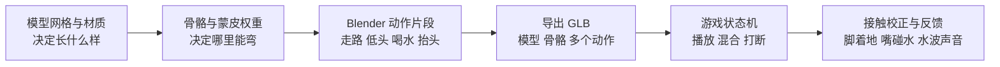
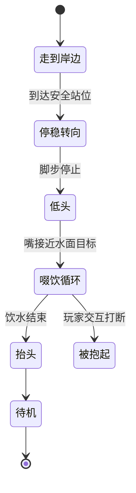

# V14 动物动作制作与验收

更新日期：2026-10-23。目标是让玩家一眼看懂动物在走路、喝水、吃草和被抱起，而不是仅靠状态文字理解。

**制作路线：先用 Blender 做一头真正带骨骼、蒙皮和动作的小牛样板，再逐个适配其他动物。** AI 可以加速模型、绑骨和部分动作，但不能代替接触校正与游戏内验收。本文件区分已有基线、制作目标和验证结果，不把方案当作完成状态。

## 从模型到会行动的动物

| 层次 | 实际负责什么 | 不能替代什么 |
|---|---|---|
| AI 模型生成 | 造型、网格、纹理 | 不等于模型已经有骨骼与动作 |
| 自动绑骨 | 建骨架、初始蒙皮权重 | 不等于关节变形和脚步已经正确 |
| Blender 动作 | 编辑关键帧、修权重、制作循环、烘焙动作 | 不决定动物何时去喝水 |
| 游戏运行时 | 寻路、选择动作、过渡、适应尺寸和水位 | 不应只用整只动物摇摆代替所有动作 |

Blender 既能手工做动画，也能用 Python 批量建骨骼和写关键帧。**脚本制作 Blender 动画仍是真实骨骼动画，前提是最终确有蒙皮、骨骼和可播放动作；“代码生成”与“骨骼动画”并不矛盾。**

## 当前基线与本次目标

| 项目 | V13 已核实基线 | V14 样板目标 |
|---|---|---|
| 牛羊猪兔 | Three.js 几何部件与 Group 层级 | 小牛先接入 Blender 导出的骨骼模型 |
| 走路 | 按距离驱动腿部旋转 | 清晰落脚节奏，动作速度与移动速度匹配 |
| 喝水 | drink 状态已存在，约 6 秒后恢复能量；与吃草共用简化低头 | 独立低头、饮水循环、抬头；嘴巴对准水面 |
| 被举起 | 运行时调整位置和姿态 | 专用被抱姿势，腹部支撑点与人物头顶对齐 |
| 美术完成度 | 程序化几何造型 | 首先验证动作管线；样板不等于最终商业美术资产 |

基线定位：`src/minimal/animal-art.ts`、`src/minimal/World.ts`、`src/minimal/model.ts`。V13 牛的 feeding 分支仅小幅前俯与下降，没有完整喝水时序；后续代码变更以实际验收记录为准。

## 喝水必须是一段能看懂的行为

| 阶段 | 玩家看到什么 | 技术要求 |
|---|---|---|
| 靠近 | 动物走向水边，不穿进池塘 | 寻路目标是岸边站位，不是水面中心 |
| 低头 | 头颈逐渐下降，前腿保持稳定 | 用嘴部锚点校准水面；不能只有身体整体下沉 |
| 喝水 | 轻微口鼻动作、水波和水声 | 特效出现于嘴与水的接触点，不能漂在身体中心 |
| 抬头 | 抬头、短暂停顿，再继续活动 | 与待机平滑过渡，不瞬间弹回 |
| 打断 | 被抱起时停止喝水 | 结束水波、水声与饮水动作，避免叠加冲突 |

池塘不可通行；小溪保留可通行规则。导航、站位和可喝水目标必须分别定义，不能用“能喝水”推导“能走进去”。

## 一套动作如何复用

| 动物或变化 | 可以复用 | 需要单独适配 |
|---|---|---|
| 牛、羊、猪 | 四足骨架层级规范、动作状态、基础步态思路 | 身长腿长、颈部幅度、蹄与嘴的接触位置 |
| 兔子 | 待机、低头、抱起的接口规范 | 跳跃节奏与身体起伏，不能直接套牛的步态 |
| 普通、大型、巨大 | 同物种模型、骨架、动作片段 | 步幅、嘴到水面距离、头顶支撑与相机遮挡 |

跨模型套动作叫动作重定向。相同骨名并不足够，还需要骨架层级、朝向、静止姿势和比例匹配。优先保留可重用的行为接口，再对每个物种做视觉校准。

## 工具能力核查

| 工具 | 官方已确认能力 | 本项目应如何使用 |
|---|---|---|
| Tripo Auto Rig | 支持四足绑骨，提供 GLB/FBX 输出 | 可做初始骨架；仍需检查权重和变形 [1] |
| Tripo Retarget API | 四足明确列出 `preset:quadruped:walk`；90+ 预设是旧版双足人形范围 | 可试四足走路，不宣称有现成牛喝水动作 [2] |
| Tripo Studio | 文档介绍动作库与 Text to Motion | 通用介绍不保证四足喝水效果，须实测 [3] |
| 混元 HY-3D-Rigging | 支持人物与动物绑骨；非人形明确不支持动作模板生成 | 可作动物绑骨入口，不等于已生成动物动作 [4] |
| 混元 HY-3D-Motion | 文档描述生成 3D 人物动作数据 | 不据此承诺牛、羊、兔的喝水 [5] |
| Mixamo | 自动绑骨与动作库限定双足人形 | 用于合适的人物，不作为牛羊默认方案 [6] |
| Blender 与 Three.js | Blender 制作和导出动画；Three.js 播放、混合和控制片段 | 本次样板的制作与运行路线 [7–9] |

没有调用付费生成服务，也没有把现有模型上传给这些服务。以上为能力调研，不代表生成服务已经接入。

## 样板验收与状态

**当前记录：Blender 小牛样板已导出并接入 World，结构、实际蒙皮几何与针对性运行时测试通过；尚未完成浏览器 WebGL 目视验收与部署验收。** 首轮发现的腿部连接、耳内侧分离与蹄底偏移已修订。仅小牛采用本次真正的骨骼资产，羊、猪、兔仍为程序化动物，不能把小牛样板完成说成所有动物已升级。

### 本次样板资产

| 内容 | 实际导出结果 |
|---|---|
| 游戏资产 | `public/models/farm/cow-animated.glb`，1,416,712 字节 |
| 可编辑源文件 | `art-source/cow-animation/cow-animated.blend` |
| 可复现脚本 | `art-source/cow-animation/build_cow.py` |
| 骨骼与蒙皮 | 26 根骨骼、1 个 skin、29/29 可见网格带蒙皮、19,014 个导出顶点 |
| 结构检查报告 | `art-source/cow-animation/validation-report.json` |
| 文件标识 SHA256 | `83708687945af7e2127d0b115e333a3b41fb65cfeac498eaef2ded21c04eee01` |

| 动作片段 | 实际时长 | 用途 |
|---|---:|---|
| `idle` | 3.000 秒 | 待机循环 |
| `walk` | 1.208 秒 | 原地步态，运行时移动距离与每循环约 0.58 米匹配 |
| `drink_enter` | 1.083 秒 | 从待机低头 |
| `drink_loop` | 2.583 秒 | 喝水循环 |
| `drink_exit` | 1.292 秒 | 抬头回到待机 |

已读取二进制验证报告：权重和最大误差约 0.000000124；待机、喝水及进入退出片段的端点姿态匹配，走路循环接缝约为浮点零误差。这只证明结构与关键帧端点，不等于整段动作没有穿模或脚滑。

最终候选改为 29 个可见网格，须以这一版重新完成运行时验收。当前 5 个片段不包含专用吃草、休息或被抱起片段，这些仍属于后续动作包，不能声称已导出。

| 验收项 | 通过标准 | 当前结果 |
|---|---|---|
| 真实骨骼资产 | GLB 含 skin、关节、顶点权重及动作通道，不是只给 Group 改名 | 最终样板 29/29 网格带蒙皮，26 骨骼与 1 skin 已核验 |
| 可复现源文件 | 保留 `.blend` 与生成脚本，导出资源路径明确 | 文件已存在，路径见上表 |
| 动作清单 | 实际导出片段名称、时长可读取；无空片段 | 已读取 5 个片段；端点检查通过 |
| 走路 | 腿有交替支撑与摆动，移动时不过度滑脚，停止后不原地踩步 | 修订版静帧已改善；循环衔接与游戏内步态待验收 |
| 喝水 | 可见低头、接近水面、啜饮、抬头；无明显穿地 | 修订版静帧接触可读；连续动作与游戏内接触待验收 |
| 多尺寸 | 普通、大型、巨大体型均能接触水面并正确举起 | 真实几何检查覆盖至 2.2 倍；浏览器目视待验收 |
| 状态切换 | 行走、饮水、待机、抱起切换无瞬移、叠加乱动 | World 加载相关测试 5/5；13 帧抱起过渡几何通过，目视待验收 |
| 交付 | 页面实际加载新资产，截图或录屏可验证；失败回退不破坏游戏 | 待部署验收 |

### 预览与验证边界

- 离线 Blender 视频：`art-source/cow-animation/preview/cow-animation-offline.mp4`，H.264，约 8.417 秒。
- 动作联系图：`art-source/cow-animation/preview/cow-animation-contact-sheet.jpg`。
- 视频与图片由实际 Blender 场景渲染，不是生成视频，也不是浏览器游戏录屏。
- 真实 GLB 的 26 个关节、29 个蒙皮网格和尺寸/抱起过渡已检查；加载进 World 的针对性测试 5/5 通过。
- 本轮整套测试曾通过 801/801，但 World 骨骼启用是在该次全量运行后加入；不能把旧全量结果当作最终代码的全量结论，最终提交需重新跑全套。
- 浏览器中的实际画面、BGM 可听性与部署仍未验收，不据此宣称正式上线或商业美术完成。

**推广顺序：小牛样板通过 → 牛的各尺寸通过 → 羊与猪适配 → 兔子专用跳跃与喝水。** 不因一头牛导出成功就声称所有动物已完成骨骼升级。

## 官方资料

1. [Tripo Auto Rig API](https://developers.tripo3d.ai/en/docs/animations-rig)
2. [Tripo Animation Retarget API](https://developers.tripo3d.ai/en/docs/animations-retarget)
3. [Tripo Rigging and Animation](https://www.tripo3d.ai/product-doc/module-post-processing/rigging-animation)
4. [腾讯云 HY-3D-Rigging](https://cloud.tencent.com/document/product/1823/137779)
5. [腾讯云 HY-3D-Motion](https://cloud.tencent.com/document/product/1823/137780)
6. [Adobe Mixamo FAQ](https://helpx.adobe.com/ie/creative-cloud/faq/mixamo-faq.html)
7. [Blender Armature Deform 与自动权重](https://docs.blender.org/manual/id/5.0/animation/armatures/skinning/parenting.html)
8. [Khronos glTF Blender 导入导出器](https://github.com/KhronosGroup/glTF-Blender-IO)
9. [Three.js 动画系统](https://threejs.org/manual/pages/animation-system.html)
10. [Hunyuan3D-2.1 开源项目](https://github.com/Tencent-Hunyuan/Hunyuan3D-2.1)：几何与 PBR 生成流程，不与商业绑骨或动作服务混为一谈。

资料核查日期：2026-10-23。服务能力可能变化；具体资产质量以导出检查与游戏内表现为准。
