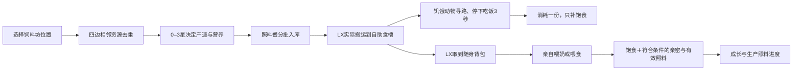
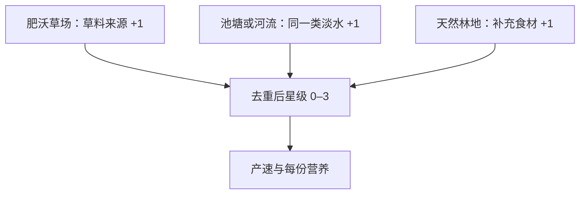

# V9 · 食堂选址、自助进食与狼袭音乐

本页记录已实现的 Demo 规则，数值为试玩参数，不是正式商业化承诺。

## 1. 自动吃饭不是替代亲密养成

|方式|真实动作与消耗|得到什么|不会得到什么|
|---|---|---|---|
|饲料坊（小食堂）|生产照料餐；库存含运输预留最多12份|减少手工补给；布局决定产速和营养|不直接给羊加亲密或改变稀有度|
|自助食槽|LX先运粮；饥饿动物走到可达餐位，吃满3秒才扣1份|饱食维护，最多维持70；减少重复照料|不刷亲密、手喂次数、共同记忆或有效生产照料|
|亲自喂养|LX走到动物身侧并完成喂养动作，消耗随身1份|单份营养补充；满足原有饥饿门槛、冷却时获得有效照料与亲密|不是每次连点都涨成长；不会直接喂出稀有动物|

动物饱食≤40会寻找有粮、可达且餐位未被预约的食槽。猛兽、恢复、休息、跟随和亲手照料优先。离开或中断不隔空扣粮、不结算未完成的一口。幼崽按幼崽进食表现，不显示嘴里叼草。

## 2. 相邻加成是资源种类，不是资源数量

建筑完整占地四边外侧的相邻格才算，斜角不算。池塘＋河流仍只加1星，多片树林仍只加1星。普通草坪、装饰树、海水不提供额外资源；盖住自然资源格后，该格不再提供相邻加成。道路不额外加星。

|星级|每批|间隔|餐食品质|每份营养|
|---|---:|---:|---|---:|
|0|3份|60秒|家常|30|
|1|3份|50秒|家常|30|
|2|3份|40秒|新鲜|36|
|3|3份|30秒|丰盛|42|

离线保留有限生产，仓满暂停。新批次采用当时选址品质；旧粮不会因为搬厂而升级。库存、运输、取消返还、食槽、随身与消费都按先入先出保留品质。旧版无品质库存迁移为家常餐。

当前地图已标出池岸肥沃草场、林地和淡水；没有新增可走河流。河流分类规则已支持后续地图，但当前不伪造河流地形。建造与移动预览显示真实星级、缺失资源、产速和营养。例：饲料坊左上格(8,7)可获得三类相邻；不能只看星数，还要看运粮路线与动物可达性。

注意：这些是免费照料餐，不是 V7 商店购买、用于产毛经济的生产口粮；本版不把两套库存悄悄合并。生产口粮、照料餐、羊毛与金币在背包仍分别展示。

## 3. 狼袭音乐

平静田园主题 → 预警小调编配 → 守护阶段轻紧张节奏 → 安全后渐回平静。共用76BPM，进入1.8秒交叉淡化、结束4.8秒回平静，不用突然放大音量制造惊吓。仍尊重首次用户手势、静音、后台暂停，不会重复快照叠加多首音乐。

## 4. 验收边界

单元与集成检查覆盖相邻去重、覆盖/搬迁、库存品质流转、自动寻路进食、抢最后一份粮、危险/手喂中断，以及音乐状态和节点回收。真实浏览器画面、触控与最终听感须以实际体验为准，自动测试不等同于人工试听。
