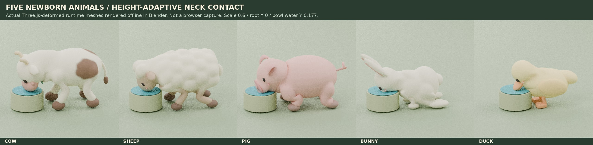

# V16 · Five genuine Blender animal rigs

## Asset and runtime contract

The minimal farm now loads sheep, pig, cow, bunny and duck as real Three.js SkinnedMesh assets with AnimationMixer controllers. Each species ships an editable Blender source and nine authored clips: idle, walk, drink_enter, drink_loop, drink_exit, eat, rest, carried, react. Grazing uses the genuine eat clip; successful care uses react for 900 ms, then blends back to the current ordinary activity. Merely selecting a card does not trigger an animal action. The optional normalized reactProgress samples a complete genuine reaction on a finite greeting timeline; outgoing reactions hold their final sampled pose while blending away instead of rewinding.

All assets use +Y up, +Z forward and Y=0 ground datum. Runtime anchors are actual bones named feeding-mouth, animal-support, animal-head and animal-ground. Species head/foot bones and the connected two-neck-bone hierarchy are validated before a template is cached or a scene accepted. A malformed chain is evicted just like a failed request, allowing an explicit retry to load corrected content. Every visible asset part is skinned, including decorative details. Full normalized-weight, topology, clip-seam and deformed geometry checks remain in the asset/offline test suites.

| Species | Actual travel per walk cycle | Authored drinking reach |
| --- | ---: | ---: |
| Cow | 0.58 m | 0.72 m |
| Sheep | 0.48 m | 0.72 m |
| Pig | 0.34 m | 0.79 m |
| Bunny | 0.42 m | 0.72 m |
| Duck | 0.32 m | 0.49 m |

World accumulates actual travel divided by current visual scale, so gait phase remains proportional to distance throughout saved growth from 0.6 to 2.2. Bunny uses authored paired hops; duck uses a two-foot land waddle. Duck navigation does not imply swimming.

## Mixing, contact and carrying

- Ordinary state transitions crossfade over 0.2 seconds with normalized weights, including interrupted transitions.
- Drinking uses the six-second arrival/lower/three-sip/rise envelope and the authored three drink clips. World uses a canonical source and frozen dry stance planned for the current and six-second future scale. Terrain contact uses true rotational two-neck-bone IK, with at most 20° of additional head pitch when a raised bowl needs a shallower muzzle orientation. Joint translations, bone lengths, root and feet are unchanged; the authored three sip pulses remain. Planner reach allowances are species- and source-specific, not a blanket 0.14 forward extension. Unreachable requests are explicitly reported in contactIK.reachable/errorWorld, never silently described as contact.
- Carried uses its own authored clip. On pickup, only the authored carried limb tracks are sampled immediately as a newborn-clearance safety mask. Head, neck, body and secondary motion still blend rather than teleport. On drink interruption, the currently solved local additive neck/head rotations fade over 0.2 s while the authored action crossfades, instead of dropping the muzzle toward the low-water pose. The root is not lifted to fake belly support.
- Cow carry was changed from extended splayed limbs to bent knees with returning lower legs. Torso-volume-aware weights keep the belly from becoming a stretched sheet. The accepted pose is backed by the actual offline carried render and independent head-contact/triangle-clearance tests. The 99th-percentile skin-edge ratio improved from 5.34 to about 3.75 before export batching; the guard is <4, not a claim of perfect production retopology.
- Successful pet/feed performance targets the accepted animal ID explicitly. A pet produces one brief heart burst; cancelled or invalid UI intentions never call the performance method.

## Ownership, diagnostics and recovery

animal-assets.ts caches one immutable template per species. Each actor receives cloned bones and materials. Geometry and clip data are shared read-only. Identical bone/inverse palettes are shared only within one actor, never between animals. Per-instance release removes the scene and disposes its own materials/palette without disposing cached geometry.

The cow's editable source retains 29 semantic mesh parts. The export joins compatible parts by material to produce nine genuine draw meshes, while preserving the same rig, skin weights and clips. Tests identify real hoof vertices by skin weights rather than relying on separate render-object names.

Every actor exposes animationSource, animationStatus, animationReady, animationError (only on failure) and animationClips in root.userData. A failed load leaves a clearly reported procedural fallback, including a distinct two-foot duck fallback, never a claimed successful skin load.

Explicit recovery is available through art.retryAnimation() and World.retryAnimalModels(). Concurrent requests coalesce by actor, World and species. Retry preserves root identity, placement, rotation, growth scale, selection target and last carried/animation pose. Late completion cannot resurrect a sold or disposed actor. The settings button appears only when failures exist; no per-frame or endless automatic retry is used.

## Owned-egg model warmup

`owned-egg-preload.ts` starts best-effort template loading from `World.update` for only the locked species in already owned bag/ground eggs. Each World latches every species before calling the existing library, once per scene lifetime, including after failure. Duplicate or bred eggs, cancelled placement and 250 ms simulation updates do not repeat a request. No animal clone is created early, and coins, saved egg values, reveal, collection and hatch timing are unchanged.

Warmup uses the same complete template Promise as `instantiate`, including optional static-picking cache registration. A hatch joins pending work or clones the completed template without another fetch. A failed warmup is not an actor failure and adds no UI or automatic retry: normal hatch may make its existing fresh attempt after eviction, and an actual failed actor retains the existing settings retry. An old already-ready egg clicked immediately, an offline connection or slow verification can still show the truthful procedural fallback; warmup does not delay hatch or guarantee invisible loading in every case.

Disposal stops new warmup attempts but never cancels shared template work. Completion has no scene/UI callback, so removal, sale or disposal cannot create a late animal. The focused nine-case gate covers genuine World/model/GLB hatch reuse, delayed picking registration, old saves, duplicate eggs, cancellation, failure/retry, synchronous/reentrant safety and late disposal. Run it with:

    node --import ./tests/view-loader.mjs --experimental-strip-types --test tests/minimal-owned-egg-preload*.test.ts

## Cache revisions and rebuild

Every GLB URL includes a revision derived from its exact SHA256 bytes. This prevents a browser's old five-clip cow cache from masquerading as a V16 asset. An explicit failed-load retry adds a new bounded request query.

After any GLB export, run:

    python3 scripts/update-animal-asset-revisions.py

This regenerates src/minimal/animal-asset-revisions.ts. The runtime regression compares the generated values with all five delivered files, so stale revision metadata fails tests. The cow build script also regenerates it automatically. Do not copy or rename large GLBs just to change their cache key.

Cow rebuild and source checks:

    blender -b -t 4 --python art-source/cow-animation/build_cow.py -- --stills
    python3 art-source/cow-animation/validate_glb.py
    blender -b -t 2 --python art-source/cow-animation/validate_blend.py
    python3 art-source/cow-animation/package_preview.py --stills-only

The nine-action still sheet and preview/cow-v16-actions-offline.mp4 are current offline Blender evidence. The MP4 contains 126 rendered frames at 12 fps (10.5 seconds) and is reproducible with render_motion_preview.py without rewriting the GLB. The original cow-animation-offline.mp4 remains byte-for-byte historical five-action evidence. Neither offline rendering nor mocked-renderer World tests prove browser WebGL/mobile frame rate; that requires a real browser/rendering acceptance pass.

## Phase 2 contact verification

The final contact and generic-runtime gate passed 183/183 tests, including the visible-muzzle geometry assertions. A later malformed-neck cache-recovery regression passed with all 11 generic tests. The preceding runtime/cow/cache/carry gate also passed 189/189. Coverage includes actual World bowls, ponds and creeks at scales 0.6,0.75,1.0,2.2; genuine enter/three-sip/exit selection; water error below 25 mm during the authored sip cycle; and unchanged skinned sole grounding. Isolated root-zero contact checks keep the mouth within 15 mm while proving exact segment lengths and head-joint translations. The contact marker is additionally required to lie within 12 mm local of actual deformed head/muzzle vertices, including jaw/bill descendants.

All 80 combinations of planner reach endpoints, water heights and growth sizes remain physically reachable with at most 20° pitch. A six-second actual World case grows by more than 0.1 scale while retaining its frozen horizontal bowl stance and contact. Constant sampling does not accumulate IK rotations; small water-height changes do not flip the near-straight neck. Impossible external targets remain explicitly unreachable without stretching joints.

Newborn bowl-to-carry/walk/react interruption initially revealed a 48–53 mm first-frame muzzle drop. The rotational additive fade reduced the worst first-frame step to 6.3 mm and maximum neck/head change to 1.25°. First-frame real LX collision clearance is an additional independent gate, not implied by these continuity assertions.



The accompanying evidence/v16-runtime-bowl-ik.json records exact asset hashes, water/mouth coordinates and the solver diagnostics for these five poses. This is actual runtime-deformed geometry under offline lighting, not browser rendering or a mobile performance claim.

### Final cow accessory clearance

The active-IK incoming-carry gate found one accessory defect at scale 0.6: a neck-only chest pendant intersected the real LX mesh during the first high-refresh pickup frames. Only its skin attachment was changed to the hide's proximal chest blend. The final cow SHA is a48d6664d9e8b1dc056fdf002bc73d5d60eec296e8e2c21babb6f4765a9ad0cd. All position/normal/color/index buffers, materials, bone transforms and every sampled channel in all nine clips remain byte-identical to the accepted original. See evidence/v16-cow-pendant-binding.json and the two source-backed export/patch scripts in art-source/cow-animation.

The exact final GLB passed independent cow size/water cases (32 real LX geometry checks), plus all 26/50 dense newborn pond interruption samples at 120/240 Hz, including the zero-time boundary. This closes the accessory collision without dropping the current solved head pose, lifting the root, hiding a detail or ignoring it in the collision oracle.

## Grounded-action transition floor repair

Genuine grounded action clips are blended over the existing 0.2 seconds. Direct joint-quaternion interpolation can put an ankle below both valid endpoint contacts. The new `animal-limb-contact.ts` caches real rigid sole vertices in each foot bone's bind frame, checks only a mixture of at least two grounded clips, with zero carried weight and no airborne hatch, and lifts only an actually penetrating ankle target using the existing two physical leg segments. It retains the blended foot orientation and X/Z trajectory. Only joint rotations change; actor roots, bone positions/scales, source GLBs and authored full-weight poses are untouched. Previous corrections are restored before mixer sampling; every grounded pose is solved afresh. Carried poses, residual carried blends and airborne hatches are excluded. The pre-existing hatch root arc is cleared before the final ground check.

This is explicitly not startup foot locking. The initial phase mismatch still causes measured first-step horizontal slide, separately from the unchanged steady stance oracle. Fully weighted authored interpolation also retains its original sub-2 mm local minimum-floor errors; this patch does not hide those by lifting the root.

Evidence: `docs/evidence/v16-transition-floor.json` records all five species at scales 0.6/1/2.2 and the isolated 3,800-pose rotational feasibility sweep. `docs/evidence/v16-transition-floor-side.jpg` shows actual World cow/duck skin at 0/50/100/150/200 ms, rendered offline in Blender, not a browser capture. `tests/minimal-animal-transition-floor.test.ts` has 43 focused cases covering 30/60/120 Hz starts/stops/interrupted restarts at nonzero phases, growth, unchanged transforms, physical chain lengths, bounded ankle continuity, rootY0 actual World, carry interruption, hatch completion and grounded walk/rest/eat/drink/reaction reversals. The worst legal giant-sheep and pig half-rest poses are shown in `docs/evidence/v16-rest-transition-giant-side.jpg`, with unchanged root and physical leg lengths. The release aggregate remains the coordinator's separate gate.

Core regression command for this repair:

```sh
node --import ./tests/view-loader.mjs --experimental-strip-types --test tests/minimal-animal-transition-floor.test.ts
```

The duck-only entry-phase alternative is read-only research and is not implemented in this release. The repair applies only while genuine grounded clips are actually mixed; fully weighted authored poses remain exact. It does not correct or mask the source clips' small pre-existing full-weight interpolation floor error.
