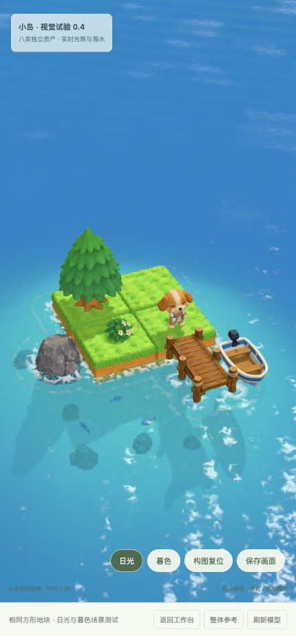
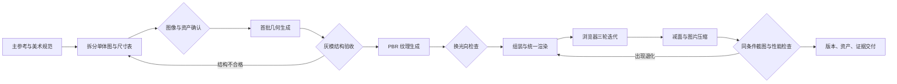

# 小岛美术资产搭建流程 0.1

这是一套已经运行过的「参考图 → 单体资产确认 → Tripo 几何与 PBR → Three.js 装配与渲染 → 减面 → 贴图压缩 → 浏览器验收」工作流，以及完整的八类资产示范工程。供其他 agent 接手制作与复现，不是单纯的效果图合集。

**流程框架版本：0.1 · 2026-10-23。** 与内部历史阶段 art/v0.1、地块 v0.2、场景 v0.3、减面 v0.4、压缩 v0.5 是不同的版本轴。本文件与 `docs/` 是当前操作入口；旧文档只说明当时发生了什么。



## 接手先做什么

1. 阅读 [AGENTS.md](AGENTS.md) 与 [交接说明](docs/HANDOFF.md)。需要可复用 skill 时，从 [SKILL.md](SKILL.md) 开始。
2. 按下方命令运行完整示例，不需要 Tripo 账户、付费或重新生成。
3. 对照 [八资产案例](examples/eight-asset-island.md)，理解文件继承关系、取舍和已知缺陷。
4. 按任务选择对应章节。新生成必须重新确认当前授权范围、计费参数、输入版本与资产验收状态，不能继承历史账单作为新任务授权。

## 从干净检出运行

在仓库根目录执行：

```sh
cd island/artdesign
python3 tools/verify_handoff.py
python3 scene-lab/server.py --port 8771
```

打开 [本地预览](http://127.0.0.1:8771/?mode=scene&material=pbr&light=sun&clean=1&dpr=1.25&geometry=runtime)。资产、Three.js 和页面代码均在仓库内；预览只监听本机回环地址。端口占用时改为 `--port 8772` 并使用对应地址。没有运行 Node 构建、安装依赖或调用 Tripo 的必要。

默认加载 `compact.glb`；不支持 WebP 的浏览器回退到 `runtime.glb`。运行时只请求所选版本，不会下载全部历史模型。完整归档体积与运行下载体积是不同概念。

## 工作流地图



| 阶段 | 操作手册 | 核心产物 |
|---|---|---|
| 设计、拆图、确认 | [01 参考图与资产](docs/01-reference-assets.md) | 主参考、单体图、独立比例表、图像验收 |
| 几何、灰模、材质 | [02 Tripo](docs/02-tripo-generation.md) | 原始 GLB、任务记录、灰模与 PBR 证据 |
| 组装、材质、光照、水体 | [03 Three.js](docs/03-assembly-rendering.md) | 场景参数、渲染模块、三轮真实截图 |
| 减面、贴图压缩 | [04 优化](docs/04-optimization.md) | display/runtime/compact、误差与体积报告 |
| 检查与交付 | [05 验收](docs/05-acceptance.md) | 视觉、性能、兼容性记录及缺口 |

## 文件在哪里

| 路径 | 内容与使用方式 |
|---|---|
| `art/v0.1/` | 原始主参考、10 类单体图、补充视图、完整生成提示词、淘汰案例和旧流程 |
| `art/v0.2/assets/ground/` | **当前有效的单块方形地块**，替代旧版 2×2 连体地块输入 |
| `scene-lab/assets/models/<id>/` | 每类完整的 geometry、texture、display、runtime、compact GLB 及派生记录 |
| `scene-lab/assets/layout.json` | 当前尺度、整体旋转、布局与接点配置 |
| `scene-lab/src/` | 可复用导入、PBR 调整、光照、水体、运动与测量模块 |
| `scene-lab/evidence/` | 灰模、PBR、五轮装配、优化前后截图和原始性能样本 |
| `tools/` | Tripo 流程、优化工具、核验脚本；工作日志不随包迁移 |
| `templates/` | 可复制的资产规格、验收记录、交付检查表 |
| `manifests/` | 当前完整资产索引、文件校验和、来源与归档差异 |

## 本案例的实际结果与边界

- 八类独立模型：狗狗、松树、方形地块、花灌木、码头、小船、岩石、鱼。另有草簇与鱼竿参考图，没有对应 Tripo 模型。
- 三角面合计 **253,531 → 143,571（减少 43.4%）**。
- 运行 GLB 体积：展示版 **14.728 MB** → 减面 **12.217 MB** → 贴图压缩 **10.172 MB**。MB 采用十进制；包含内嵌贴图，不含页面脚本。
- 图片压缩没有降低分辨率；法线/材质图像素无损，颜色图轻度有损。没有实施 KTX2 GPU 压缩，不能据此宣称显存下降。
- 转动时倒影由原来约 15 Hz 改为逐帧更新。桌面受控样本约 60 FPS，不能推断所有手机 60 FPS。
- 仍有狗尾偏长、叶片粘连、灌木针孔、地块宽深不完全一致等问题，未达到参考图最终品质。真实手机、温升、跨浏览器仍待测。最后贴图轮次按用户要求停止额外验收，不能补写成完整通过。

完整索引见 [资产清单](manifests/asset-inventory.json) 与 [文件 SHA-256](manifests/files.json)；本次移交副本的实测结果见 [归档核验](docs/VERIFICATION.md)。

来源、授权边界与依赖见 [PROVENANCE.md](manifests/PROVENANCE.md) 与 [THIRD_PARTY_NOTICES.md](THIRD_PARTY_NOTICES.md)。本次归档不含凭据、账户配置、临时下载链接或原始私有任务日志。
