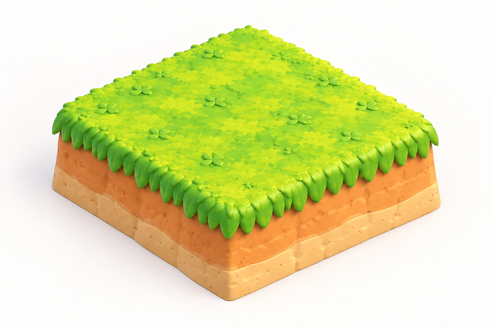

> 历史阶段资料：保留当时的设计与结果，不代表当前状态。当前入口见 [流程框架 0.1](../../README.md)。

# 美术参考增量 v0.2 · 单块方形地块

本版仅更新 GROUND，其余资产继续使用 v0.1。

- [方形单元参考图](assets/ground/primary.png)
- [提示词与检查记录](assets/ground/PROMPT.md)

将 v0.1 的 2×2 岛体参考改为一个可重复使用的方形单元：顶部连续、没有分割沟，四条主要边界规整，保留小倒角以及原草皮／土层／浅砂材质。

此图不定义绝对米制尺寸。建模时按同一母件复制排列，校准相同边长、平整接面与层高；实际拼接效果仍需 3D 验证。

