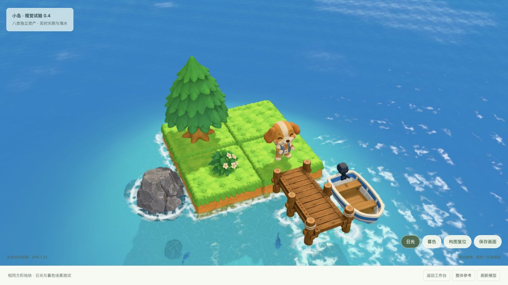

# 框架 0.1 归档核验 · 2026-10-23

这是“移交副本可用性”核验，不是重新制作或最终美术验收。

## 本次实测

| 项目 | 结果与证据 |
|---|---|
| 文件/资产清单 | `tools/verify_handoff.py` 核对全包文件集合、字节、SHA-256，40 个内嵌 GLB 的版本/长度/统计与本地 Markdown 链接 |
| 原件保真 | 118 个原有图片、SVG、GLB 与源项目逐字节哈希一致；新增本次浏览器截图另列，不冒充原历史证据 |
| skill 结构 | 官方 skill-creator 的 quick_validate.py 通过 |
| 流程脚本 | 11 项 Python 离线测试通过；本轮未请求生成、未消费 Tripo 积分 |
| 场景脚本 | npm 语法检查通过；导入/整体变换/接点/实例/缓存释放/WebP 回退检查通过 |
| 倒影逻辑 | 相机移动逐帧更新、静止复用、尺寸/灯光失效、渲染目标恢复检查通过；本轮未重新采样 FPS |
| 减面 | 8 类 source/output 哈希、贴图字节、PBR、节点变换、保留顶点属性和索引检查通过 |
| 图片压缩 | 8 类几何/PBR/变换相同；数据图解码像素完全一致，颜色图误差门槛通过；12,216,880 → 10,171,808 bytes |
| 浏览器启动 | 从移交副本在 127.0.0.1:8772 启动，Codex 内置真实浏览器显示完整八类资产；抓取的 warning/error 日志为空 |
| 本机引用与凭据 | 文本扫描未见作者绝对路径、私钥、字面量长 Bearer/GitHub token、下载签名；账户配置与 work 原始任务响应未纳入包 |

预览参数：`?mode=scene&material=pbr&light=sun&clean=1&dpr=1.25&geometry=runtime`，1280×720 截图；桌面场景，未冒充手机。画面证据：



## 依赖与出现过的失败

本次基础检查 Python 3.14.2、Node.js 24.9.0、npm 11.6.0；贴图核验使用已有 Python 3.12 图像环境与锁定依赖。npm 的纯离线安装因缓存缺少 uniq 包失败，之后从官方 npm registry 按 package-lock 安装成功（47 个包，ignore-scripts），再完成减面核验。首次启动本机端口被沙箱限制，获工具权限后以仅回环监听启动成功。这两项不是模型或 Shader 故障，没有隐去失败。Git 空白检查在自有文件范围通过；vendor 中上游已有的空白格式告警保留原样，不重写第三方源码。

本轮未重新编码素材、未做新图像生成或新 Tripo 任务。纯预览不要求安装 npm/Python 图像依赖；仅优化工具需要这些依赖。

## 仍然不支持的结论

没有重新完成三轮美术迭代，没有真实手机/温升/跨浏览器/移动网络测试，没有证明达到原参考图最终品质。原阶段的成功和失败样本原样保留；最后贴图轮次按用户要求停止额外验收。这些边界见 [检查与验收](05-acceptance.md) 与 [案例](../examples/eight-asset-island.md)。

## 有意修改后更新清单

先查看 diff 和新的视觉/数值证据，再执行：

```sh
python3 tools/build_handoff_manifest.py --refresh
python3 tools/verify_handoff.py
```

这只重新索引当前文件，不把失败检查变成通过，也不重建历史 Tripo 账单。不要在未知哈希变化后直接刷新来掩盖差异。历史账单工具 build_asset_manifest.py 在没有本地任务记录时会停止并保留原账单；当前归档索引不依赖私人任务记录。
