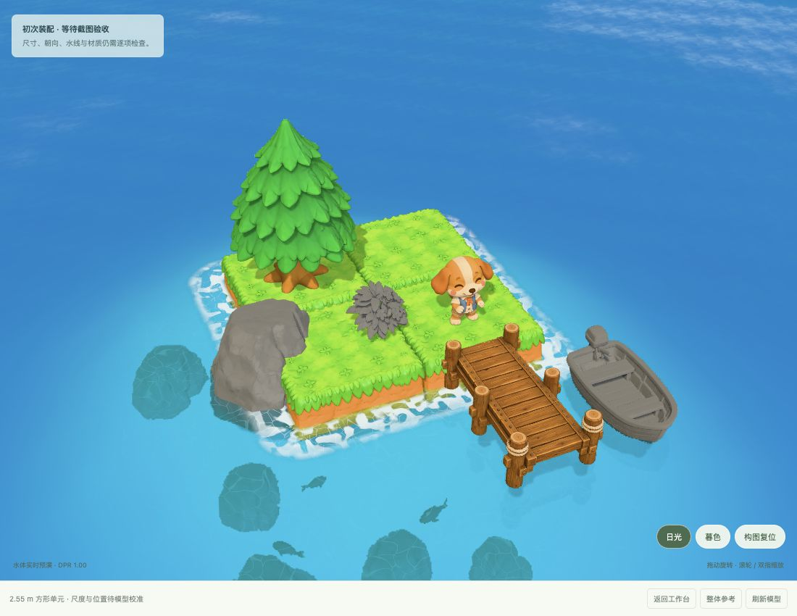
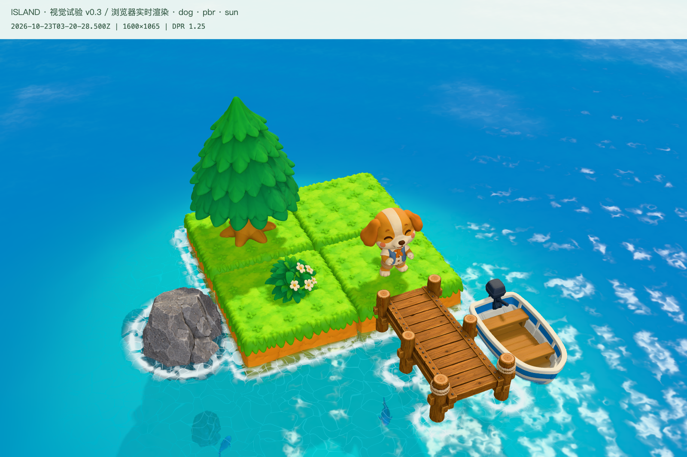
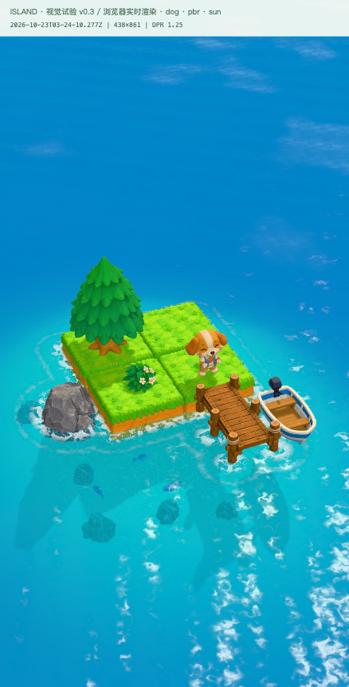
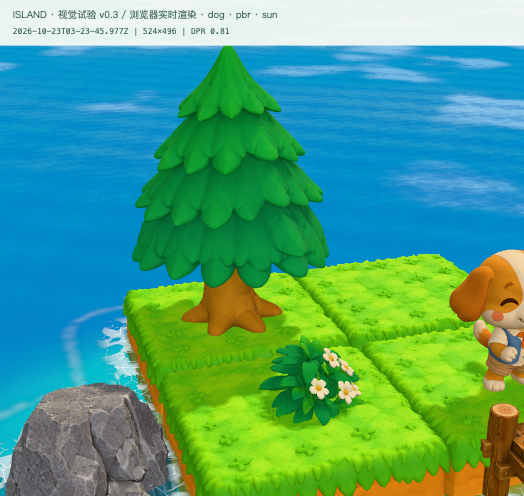
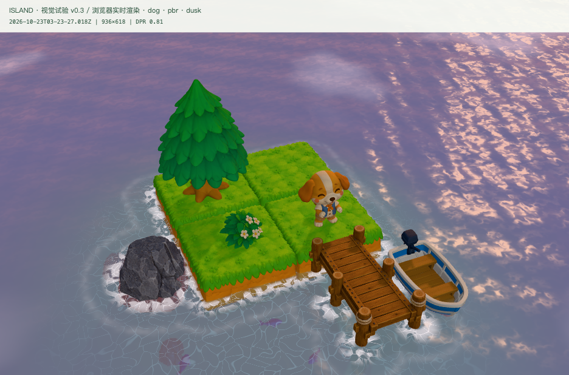

> 历史阶段资料：保留当时的设计与结果，不代表当前状态。当前入口见 [流程框架 0.1](../../README.md)。

# 小岛视觉试验 0.3 · 本轮交付

2026-10-23。历史源工程已归档在本目录。

[打开日光预览](http://127.0.0.1:8771/?mode=scene&material=pbr&light=sun&clean=1&dpr=1.25) · [打开资产工作台](http://127.0.0.1:8771/)

原轮次曾启动本机预览；本归档需在 artdesign 目录执行 `python3 scene-lab/server.py` 自行启动。预览只监听本机，不需要 API 密钥，也不会发起生成。

## 本轮结果

狗狗、松树、方形地块、花灌木、码头、小船、岸石、鱼，八类独立资产均经过几何生成、灰模看图、PBR 生成与场景装配。地块使用相同的单块母件复制四次，原始文件与展示副本分别保存。

本轮实际消耗 **380 积分**，完成后查询余额 **620 积分**。没有额外付费重抽。

按最新反馈校准了四处关系：

- 狗狗整体高度改为 1.55m，保持完整头颈和五官关系，脚底按真实地表接点放置。
- 花灌木移至左前地块，转正花朵方向并将根部埋入草皮；近景已复核。
- 小船沿码头右侧靠泊，与柱子保留空隙；屏蔽船舱内水面，避免海水穿舱。
- 岸石移到地块左侧，缩减横向占地；从主视角与侧面复核草皮边界。

海水具有动态折射、反射、深度颜色、焦散和岸线泡沫；统一色彩管理、日光/黄昏光照、微风、鱼尾摆动与船体轻微起伏已接入。

## 实际画面证据

下面均为真实浏览器画面，没有使用生成图片代替运行结果。早期画面部分资产尚未完成材质，不能作为同材质条件下的渲染对照。

初次装配（round-03）：

最终日光全景（round-05）：

最终竖屏：

植物近景与黄昏：

完整证据保存在 `scene-lab/evidence/round-01` 至 `round-05`。各轮问题与修正见 [视觉验收记录](VISUAL-REVIEW-v0.3.md)。

## 性能与保留问题

本机浏览器 390×844 CSS 竖屏、完整场景、倍率 1.25 的 12 秒采样平均 **59.5 FPS**，P95 帧时间 **18.4ms**。相同倍率 1.5 的优化前后为 39.9 → 46.1 FPS；降倍率也贡献了性能提升。大视口可能触发自动降分辨率；最终近景和黄昏截图记录了当时的实际倍率。

八个展示 GLB 共约 **14.05 MiB**，原始 PBR 共约 **108.65 MiB**。没有使用 KTX2；图片文件变小不等于 GPU 压缩。实际横竖屏、拖动旋转、滚轮缩放已检查；**真实手机、触屏双指、温升与跨浏览器兼容性未验证**。

当前可用于比较制作流程与整岛效果，尚未达到原参考图的最终品质。狗尾偏长、树叶局部粘连、灌木少量针孔、岩石材质偏写实仍需精修。地块宽深约有 2% 差异，正式模块化生产需要统一边界。没有开发角色骨骼动画、钓鱼玩法或修改经济和存档。

代码语法检查、10 项离线流程检查、GLB 导入/整体变换/甲板接点/实例复用检查已通过。原始几何、UV 与拓扑在展示副本中保持不变。详细数据见 [性能记录](PERFORMANCE.md) 与 [资产清单](ASSET-MANIFEST.md)。

## 文件与复用

- `art/`：参考图、元素图和流程 0.1，地块更新版 0.2。
- `scene-lab/assets/models/`：八类资产的原始几何、原始 PBR、展示 GLB。
- `scene-lab/assets/layout.json`：尺寸、朝向与装配位置。
- `scene-lab/src/asset.js`、`materials.js`、`lighting.js`、`lagoon.js`、`motion.js`：资产、材质、光照、水体与轻量动画模块。
- `tools/`：有任务记录和防重复提交检查的生成流程、展示纹理处理与清单工具。
- `scene-lab/evidence/`：五轮浏览器截图及性能采样。

独立分支 `visual/tripo-v03` 保存代码、文档与资产清单。模型和截图保存在项目文件夹但不提交 Git；凭据和原始任务日志不纳入交付。
